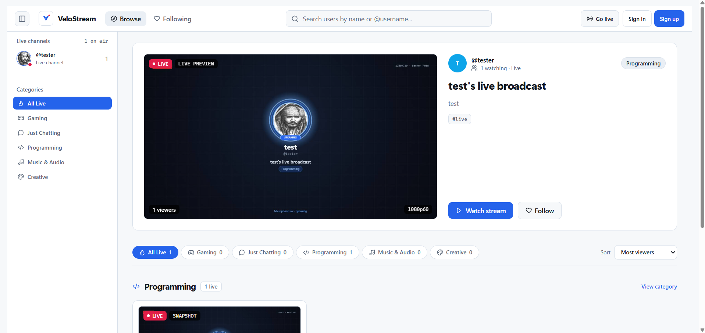
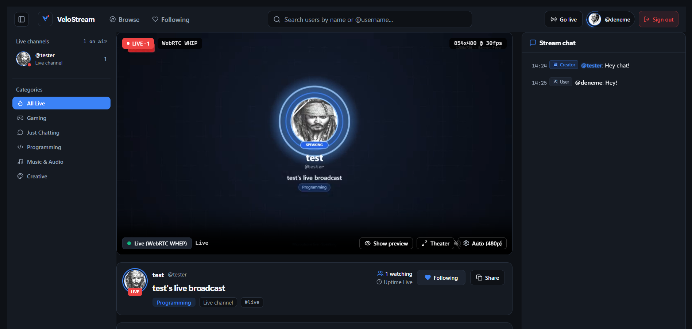
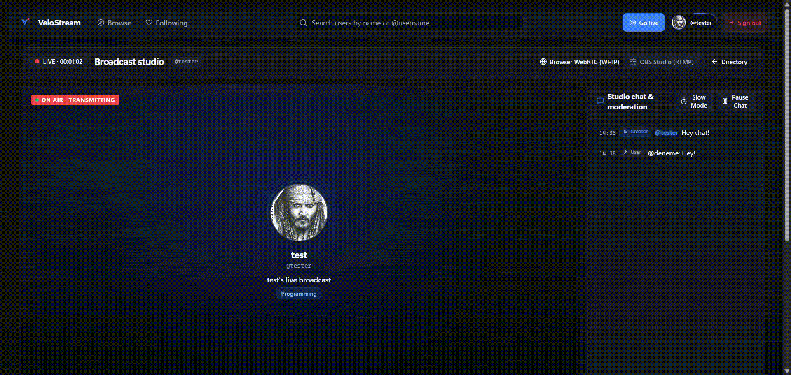
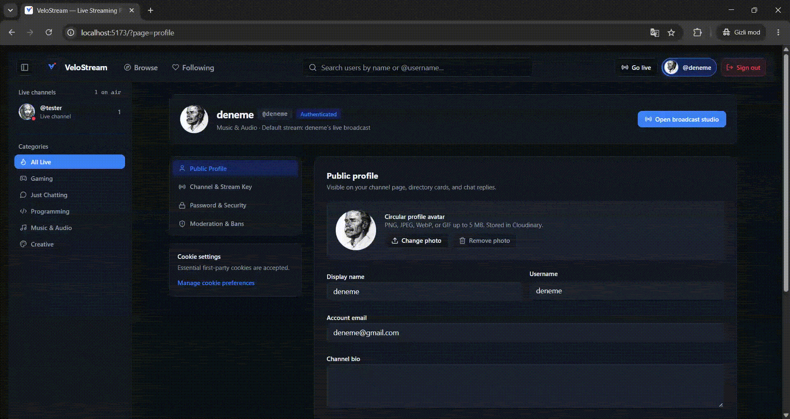
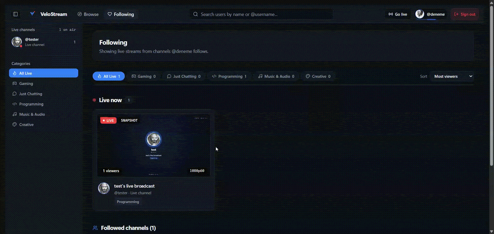
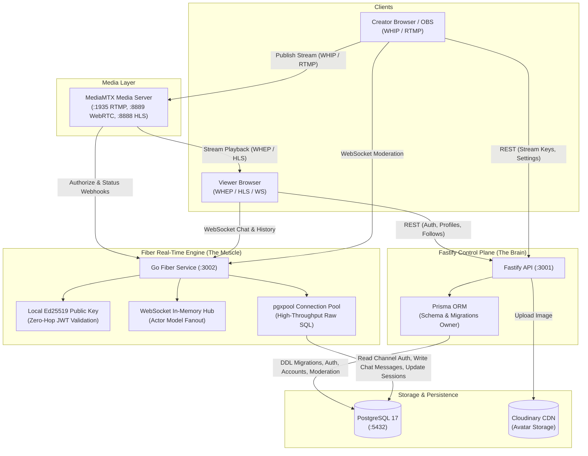

# VeloStream

VeloStream is a high-concurrency, polyglot live streaming and real-time interaction platform. It is engineered with a decoupled service-oriented architecture designed to handle low-latency video ingestion and playback, massive concurrent WebSocket chat connections, cryptographic identity validation, and channel moderation.

The platform pairs a Node.js/Fastify control plane ("The Brain") for relational schema management, asymmetric authentication, and business workflows with a Go/Fiber execution service ("The Muscle") for real-time WebSocket fanout and media server webhook coordination.

---

## Visual Showcase

### Channel Discovery and Browse
The discovery stage provides a responsive directory of active broadcasts, category filters, search indexing, and a featured live preview stage.



### Live Playback and Real-Time Chat
Broadcasters stream with sub-second latency. Viewers interact through a concurrent WebSocket chat system supporting role badges, theater mode, and viewer count telemetry.



### Broadcaster Studio
Content creators can broadcast directly from the browser using WebRTC WHIP without third-party software, or connect through external software such as OBS Studio via RTMP. The studio interface provides live stream metrics, health monitors, and moderation controls including slow mode and chat pause.



### Channel Configuration and Profile Management
Users can customize channel metadata, generate and rotate stream keys, upload profile avatars directly to Cloudinary storage, manage account security, and review moderation bans.



### Personalized Following Feed
Viewers can follow channels to receive live status indicators and track their favorite broadcasters from a dedicated feed.



---

## Architecture Overview

VeloStream divides operational responsibilities into distinct functional layers:

1. **Frontend (The Stage):** React 19 single-page application built with Vite and Tailwind CSS. Provides WebRTC WHIP broadcasting, WebRTC WHEP / HLS.js playback, and full WebSocket chat interactivity.
2. **Fastify Core API (The Brain):** Node.js and TypeScript service utilizing Prisma ORM. Sole owner of the PostgreSQL schema and migrations. Issues asymmetric Ed25519 (EdDSA) JSON Web Tokens, manages user credentials, Cloudinary media storage, stream keys, and moderation directives.
3. **Fiber Real-Time Service (The Muscle):** Go service leveraging Fiber and `pgxpool`. Operates an in-memory hub with non-blocking per-client channels for WebSocket chat rooms. Verifies Fastify-issued JWTs locally using an asymmetric public key without cross-service network calls. Handles MediaMTX media server authentication and stream lifecycle webhooks.
4. **Media Router (MediaMTX):** High-performance media server supporting RTMP ingestion, WebRTC WHIP ingestion, WebRTC WHEP playback, and HLS streaming.
5. **Database (PostgreSQL 17):** Shared persistence layer storing users, channels, stream sessions, follows, messages, bans, and moderation records.

### Service and Database Interaction Diagram



### Database Access Separation

To guarantee data consistency while sustaining high throughput:

- **Schema Ownership:** Only the Fastify service executes Prisma migrations and DDL statements. The Prisma schema located at `backend/fastify/prisma/schema.prisma` is the canonical source of truth for all database tables and constraints.
- **Transactional Accounts & Administration:** Fastify manages user registration, password hashing (Argon2 via pgcrypto/jose), session refresh tokens, profile mutations, channel creation, and moderation entity administration.
- **High-Throughput Queries & Persistence:** Fiber directly accesses the Prisma-managed tables using parameterized SQL via `pgxpool`. Fiber validates stream keys upon media ingest, updates live broadcast flags and session counters during stream status transitions, and persists chat messages at scale without ORM overhead.
- **Asymmetric Zero-Hop Verification:** Fastify signs JWT access tokens with a private Ed25519 key. Fiber loads Fastify's public key once on startup (or from disk) and validates incoming WebSocket connection tokens in memory, eliminating synchronous HTTP calls between microservices during client authentication.

---

## Interactive API Documentation (Swagger / OpenAPI)

Both backend microservices expose interactive OpenAPI 3.0 documentation via Swagger UI. Developers can inspect route schemas, authentication requirements, request/response models, and test endpoints directly from the browser.

### Fastify Core API Docs
- **Swagger UI:** `http://localhost:3001/docs`
- **OpenAPI JSON Specification:** `http://localhost:3001/docs/json`
- **Documented Modules:**
  - `Auth`: User registration, credential login, token refresh, revocation, session logout, and JWKS public key distribution.
  - `Users`: Profile retrieval, username search, user updates, channel follow/unfollow operations, and avatar file uploads.
  - `Channels`: Channel metadata configuration and stream key generation/rotation.
  - `Moderation`: Channel ban and unban management.

### Fiber Real-Time API Docs
- **Swagger UI:** `http://localhost:3002/docs`
- **OpenAPI JSON Specification:** `http://localhost:3002/docs/openapi.json`
- **Documented Modules:**
  - `MediaMTX Webhooks`: Ingest authentication verification (`/webhooks/mediamtx/auth`), stream publish notification (`/webhooks/mediamtx/publish`), and stream unpublish tear-down (`/webhooks/mediamtx/unpublish`).
  - `Chat WebSocket`: Real-time chat connection endpoint (`/ws/chat/:channel`) with payload frame specifications.
  - `Chat History`: Historical message retrieval for channel catch-up.
  - `Giphy Proxy`: Proxied GIF search endpoint ensuring client keys remain secure.

---

## Technology Stack

| Layer | Technology | Purpose |
|---|---|---|
| **Frontend** | React 19, TypeScript, Vite | Client user interface |
| | Tailwind CSS, Lucide / React Icons | Design system and layout |
| | WebRTC (WHIP / WHEP) | Sub-second camera broadcasting and playback |
| | HLS.js | Adaptive HTTP Live Streaming playback fallback |
| | React Toastify | System notifications and action feedback |
| **Control Plane API** | Node.js (>= 22), Fastify, TypeScript | Scalable REST microservice |
| | Prisma ORM | PostgreSQL schema modeling and migration control |
| | Jose | Asymmetric Ed25519 token signing and validation |
| | Fastify Swagger & Swagger UI | Interactive OpenAPI documentation |
| | Cloudinary SDK | Cloud image and avatar asset pipeline |
| **Real-Time Service** | Go (1.24), Fiber v2 | High-throughput concurrent microservice |
| | `pgx/v5` (`pgxpool`) | Connection pooled PostgreSQL driver |
| | Fiber WebSocket | Low-latency chat rooms and fanout broadcasting |
| | Golang JWT v5 | Local cryptographic token verification |
| **Media Server** | MediaMTX | Ingest router (RTMP, WebRTC WHIP/WHEP, HLS) |
| **Persistence** | PostgreSQL 17 | Relational database storage |
| **Containerization** | Docker, Docker Compose | Multi-container development and deployment |

---

## Getting Started

### Prerequisites

- **Docker & Docker Compose:** Docker Desktop 4.x or Docker Engine with Docker Compose v2.
- **Node.js:** Node.js 22.x or later with npm 10.x or later.
- **Go (Optional for host development):** Go 1.24 or later.

### 1. Clone Repository and Configure Environment

```bash
git clone https://github.com/your-username/VeloStream.git
cd VeloStream
```

Copy the example environment file:

```bash
cp .env.example .env
```

Review `.env` and configure optional integrations such as `CLOUDINARY_URL` if you want profile picture uploads enabled. Default settings are pre-configured for local containerized execution.

### 2. Generate Cryptographic Key Pairs

Generate the asymmetric Ed25519 key pair used for JWT authentication:

```bash
npm run keys:generate
```

This writes `jwt-private.pem` and `jwt-public.pem` into the `.keys/` directory. These keys are mounted as read-only volumes into the Fastify and Fiber containers.

### 3. Launch with Docker Compose

Build and launch all services in detached mode:

```bash
npm run up
```

This starts:
- `velostream-postgres` (PostgreSQL 17 on port 5432)
- `velostream-mediamtx` (MediaMTX on ports 1935, 8888, 8889, 8189/udp, 9997)
- `velostream-fastify` (Fastify API on port 3001)
- `velostream-fiber` (Fiber real-time service on port 3002)
- `velostream-frontend` (Nginx serving React SPA on port 80)

Verify that all containers are healthy:

```bash
npm run ps
```

### 4. Access the Application

- **Web Application:** `http://localhost`
- **Fastify API & Swagger:** `http://localhost:3001/docs`
- **Fiber API & Swagger:** `http://localhost:3002/docs`
- **MediaMTX HLS Stream Base:** `http://localhost:8888`
- **MediaMTX WebRTC (WHIP/WHEP):** `http://localhost:8889`
- **MediaMTX RTMP Ingest:** `rtmp://localhost:1935/live`

---

## Broadcasting Guide

### Browser Studio (WebRTC WHIP)
1. Sign up or log into an account at `http://localhost`.
2. Click **Go Live** in the top navigation bar to open the Studio.
3. Allow camera and microphone access when prompted by the browser.
4. Select your audio/video devices, set your title and category, and click **Start Streaming**.
5. The broadcast connects to MediaMTX via WebRTC WHIP and marks your channel live automatically.

### External Streaming Software (OBS Studio / RTMP)
1. Log into your account and navigate to **Profile -> Channel & Stream Key**.
2. Copy your private **Stream Key**.
3. In OBS Studio, open **Settings -> Stream**:
   - **Service:** Custom...
   - **Server:** `rtmp://localhost:1935/live`
   - **Stream Key:** `your-stream-key`
4. Click **Start Streaming** in OBS. Fiber verifies your key via the MediaMTX auth webhook, transitions the channel to live, and starts your session.

---

## Local Host Development (Hybrid Mode)

If you prefer running services directly on your host machine while running infrastructure in Docker:

1. Start database and media infrastructure:
   ```bash
   npm run infra:up
   ```
2. Run database migrations:
   ```bash
   npm run prisma:migrate -w @velostream/fastify
   ```
3. Start the Fastify API (terminal 1):
   ```bash
   npm run dev:fastify
   ```
4. Start the Fiber service (terminal 2):
   ```bash
   cd backend/fiber
   go run main.go
   ```
5. Start the Frontend development server (terminal 3):
   ```bash
   npm run dev:frontend
   ```
   The Vite dev server runs at `http://localhost:5173`.

---

## Verification and Testing

VeloStream maintains test coverage across every workspace:

```bash
# Typecheck TypeScript workspaces
npm run typecheck

# Lint codebase
npm run lint

# Run Fastify unit and integration tests
npm run test -w @velostream/fastify

# Run Fiber Go test suite
cd backend/fiber && go test -v ./...

# Run Frontend unit and component tests
npm run test -w @velostream/frontend

# Run Frontend Playwright end-to-end tests
cd frontend && npx playwright test

# Full cross-stack verification suite
npm run verify:all
```

---

## Container Lifecycle Commands

| Command | Action |
|---|---|
| `npm run up` | Build and start all project containers |
| `npm run up:fresh` | Force-recreate containers and rebuild images |
| `npm run down` | Stop and remove containers (preserves database volume) |
| `npm run down:clean` | Stop containers and remove persistent database volumes |
| `npm run restart` | Rebuild images and restart the entire stack |
| `npm run logs` | Follow output logs across all running containers |
| `npm run ps` | Display current status and health of all containers |

---

## License

This project is licensed under the MIT License.
